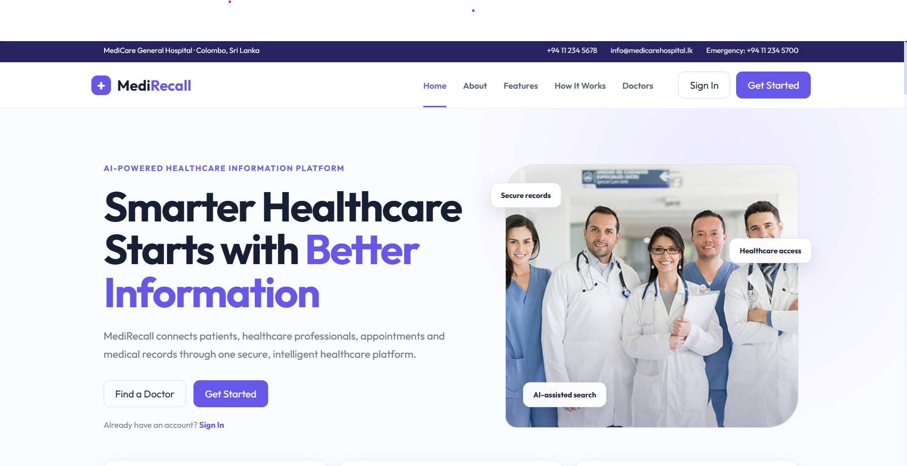
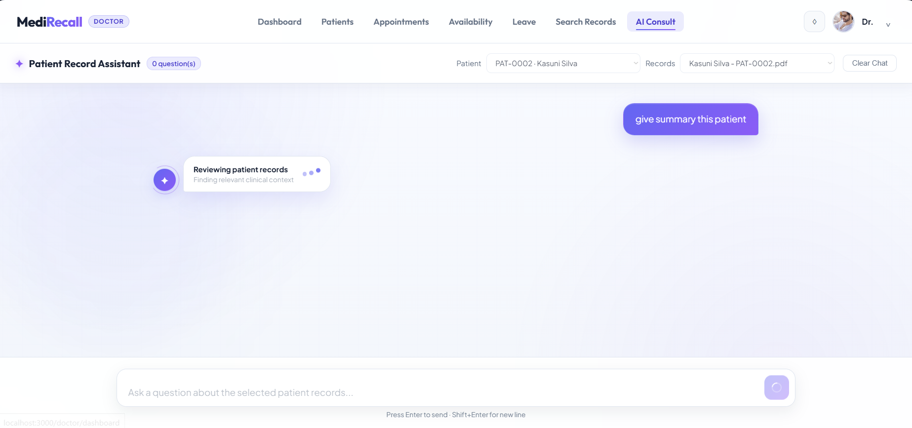
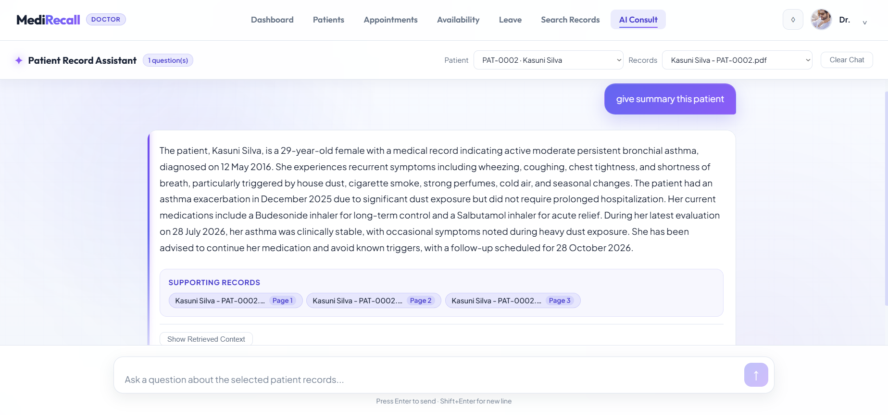

# MediRecall

MediRecall is an AI-powered healthcare information platform for securely managing patient records, appointments, clinical workflows, and intelligent medical-record search. It combines role-based hospital management with a Retrieval-Augmented Generation (RAG) assistant that helps clinicians find and summarize relevant information from patient documents.

> **Important:** MediRecall is intended as a software project and clinical decision-support prototype. AI-generated responses must be reviewed by a qualified healthcare professional and must not be treated as a diagnosis or a substitute for professional medical judgment.

## Screenshots

### Public landing page



### AI patient-record assistant



### Record summary with supporting sources



## Key Features

- Role-based access for administrators, doctors, and patients
- Secure authentication and protected application routes
- Patient profiles and longitudinal medical-record workspaces
- PDF medical-document upload and management
- AI-assisted semantic and keyword-based patient-record retrieval
- Patient-record summaries with supporting source references
- Doctor directory and public doctor profiles
- Appointment booking and management
- Doctor availability, leave, and blocked-date management
- Notifications, system logs, and hospital operations tools
- Responsive public and authenticated user interfaces

## Technology Stack

| Layer | Technologies |
| --- | --- |
| Frontend | React, React Router, Axios, Create React App |
| Backend API | Node.js, Express, Mongoose, JWT, Multer |
| AI service | Python, FastAPI, LangChain, OpenAI |
| Retrieval | ChromaDB, BM25, OpenAI embeddings |
| Database | MongoDB / MongoDB Atlas |

## Architecture

```text
React frontend (:3000)
        |
        v
Express API (:5000) ------> MongoDB
        |
        v
FastAPI AI service (:8000) ------> OpenAI + ChromaDB
```

The React client communicates with the Express API. Express handles authentication, application data, uploads, and hospital workflows, while forwarding AI document and chat operations to the FastAPI RAG service.

## Project Structure

```text
.
|-- frontend/             React web application
|-- backend/              Express REST API and MongoDB models
|-- ai-service/           FastAPI RAG and document-processing service
|-- docs/
|   `-- screenshots/      README screenshots
`-- README.md
```

## Prerequisites

Install the following before starting the project:

- Node.js and npm
- Python 3.10 or later
- MongoDB locally, or a MongoDB Atlas cluster
- An OpenAI API key

## Environment Configuration

Create `backend/.env`:

```env
PORT=5000
MONGODB_URI=mongodb://127.0.0.1:27017/medirecall
AI_SERVICE_URL=http://localhost:8000
JWT_SECRET=replace_with_a_long_random_secret
FRONTEND_URL=http://localhost:3000
```

For MongoDB Atlas, replace `MONGODB_URI` with the connection string for your cluster and allow your current IP address in Atlas Network Access.

Create `ai-service/.env`:

```env
OPENAI_API_KEY=your_openai_api_key
```

Never commit real secrets or `.env` files to source control.

## Installation

### 1. Frontend

```powershell
cd frontend
npm install
```

### 2. Backend

```powershell
cd backend
npm install
```

### 3. AI service

```powershell
cd ai-service
python -m venv venv
.\venv\Scripts\Activate.ps1
python -m pip install -r requirements.txt
```

## Running the Application

Start each service in a separate terminal from the repository root.

### Terminal 1 — AI service

```powershell
cd ai-service
.\venv\Scripts\python.exe -m uvicorn app.main:app --reload --port 8000
```

### Terminal 2 — Backend API

```powershell
cd backend
npm start
```

### Terminal 3 — Frontend

```powershell
cd frontend
npm start
```

Open [http://localhost:3000](http://localhost:3000) in a browser.

Service URLs:

| Service | URL |
| --- | --- |
| Frontend | `http://localhost:3000` |
| Backend API | `http://localhost:5000` |
| AI service | `http://localhost:8000` |
| FastAPI documentation | `http://localhost:8000/docs` |

## Initial Setup and Roles

When the application has no administrator, open `/setup` to create the initial admin account. The application then provides dedicated workflows for:

- **Administrators:** doctor management, patient documents, uploads, system logs, and hospital operations
- **Doctors:** patient workspaces, record search, AI consultation, appointments, availability, and leave
- **Patients:** doctor discovery, appointment booking, medical records, and notifications

## Testing

Run backend tests:

```powershell
cd backend
npm test
```

Run AI-service tests:

```powershell
cd ai-service
.\venv\Scripts\python.exe -m pytest
```

Run frontend tests:

```powershell
cd frontend
npm test
```

## Security Notes

- Keep MongoDB credentials, JWT secrets, and OpenAI API keys outside Git.
- Restrict MongoDB Atlas Network Access to trusted IP addresses.
- Use a strong, randomly generated `JWT_SECRET` outside development.
- Review access-control rules and AI output handling before any real-world deployment.
- Do not use real patient information in development or demonstrations.

